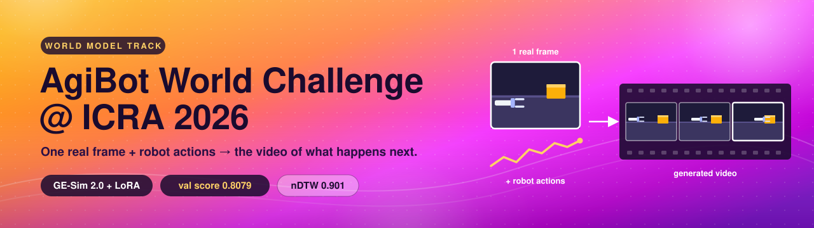
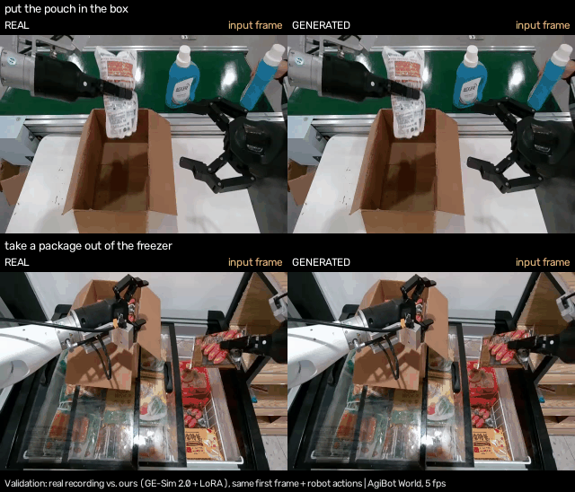
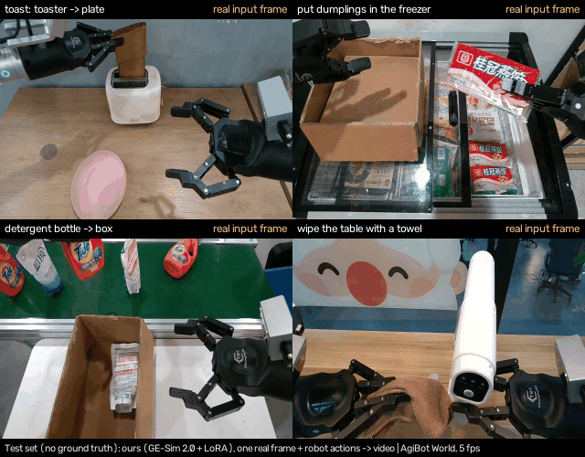

<p align="center">
  
</p>

<p align="center">
  
  
  
  
</p>

# Predicting robot video from a single frame

This repo is my entry for the **World Model track of the [AgiBot World Challenge @ ICRA 2026](https://agibot-world.com/challenge2026)** ([dataset](https://huggingface.co/datasets/agibot-world/AgiBotWorldChallenge-2026)). It contains the code I used to fine-tune, run and evaluate the model, plus the notes I wish I'd had when I started.

## The challenge Description

A dual-arm AgiBot robot works on everyday tasks: taking toast out of a toaster, packing a box, loading a freezer. For each episode the challenge gives you:

- **one real frame** from the robot's head camera, the moment the clip starts;
- **the robot's actions** for the rest of the episode (arm poses and gripper openings);
- the camera calibration.

From that, the model has to **generate the video the head camera would record**, frame by frame at 5 fps, as the robot carries out those actions. There's no earlier video to work from: one image and a plan of motion is all it gets.

Submissions are scored on three things, averaged:

| metric | what it rewards |
|---|---|
| **PSNR** (clipped at 35, divided by 35) | pixels that match the real recording |
| **Scene consistency** (DINOv2 features) | the scene staying the same scene, with no melting or drifting objects |
| **nDTW** (gripper trajectories) | the robot's grippers moving the way the real ones did |

## Where I ended up

My final model is **GE-Sim 2.0** (AgiBot's distilled 2B video world model, 4 denoising steps), fine-tuned with a **rank-64 LoRA**. I added two fixes aimed at the grippers, which is where the score was being lost (more on that below).

On the full 189-clip validation set, scored with my local re-implementation of the challenge metrics:

| model | PSNR | scene cons. | nDTW | **score** |
|---|:-:|:-:|:-:|:-:|
| Static first frame, repeated (a floor) | 18.16 | 1.000 | 0.178 | 0.5657 |
| GE-Sim 2.0 + LoRA, plain loss | 21.28 | 0.913 | 0.860 | 0.7936 |
| **+ edge-clipped action band + gripper-weighted loss (final)** | **21.36** | **0.912** | **0.901** | **0.8079** |
| EVAC, published reference | | | | ≈ 0.8025 |

## See it in action

**Validation: the real recording (left) vs. my model's video (right).** Both start from the same single frame and follow the same recorded actions. Everything after the first frame on the right is generated.

<p align="center">
  
</p>

**Test set.** No ground truth has been released for these, so there's only the generated side:

<p align="center">
  
</p>

<sub>I picked these clips by eye as clear task completions, so they're the good cases, not the average. The captions are my descriptions, not official task names. Both GIFs are rebuilt by <code>eval/make_demo_gif.py</code>.</sub>

## How I got here

### 1. Starting point: GE-Sim 2.0 out of the box

My first submission used the original GE-Sim and scored **0.6619**. Switching to GE-Sim 2.0 was the obvious next step, but it's trained on 30 fps data and the challenge is 5 fps. Feeding it 5 fps actions directly scored **0.6101** on my 30-clip subset. Interpolating the actions up to 30 fps (cubic splines for positions, slerp for rotations), generating, and keeping every 6th frame scored **0.6549** on the same subset. So I upsample everywhere.

### 2. Fine-tuning with LoRA

I fine-tuned a rank-64 LoRA on 280 linear layers of the transformer. The objective is the same x0-regression the distilled model uses, evaluated at its four sigmas, on about 32.2k training clips (1% of episodes held out for validation).

- A quick 200-step run already moved the 30-clip subset to **0.7304**.
- The long run (lr 1e-4, best checkpoint at step 3000) reached **0.7936** on all 189 validation clips.

Memory was the main constraint. With partial gradient checkpointing (`--keep-blocks`), a 48 GB card fits 22 of 28 blocks without checkpointing (about 2 s per sample) and a 32 GB RTX 5090 fits 13.

### 3. Finding where the score was lost: the grippers

When I sorted the validation clips by loss, **19 clips held 61% of all the nDTW loss**: 10 scored exactly zero and 9 were below 0.5. They're listed in `eval/val_hard.txt`. Two things stood out:

- **Grippers near the image edge got no guidance at all.** GE-Sim tells the model where the grippers should go by drawing a "trajectory band" (circles and axis sticks at each gripper's projected position) into a conditioning image. Its renderer skips a gripper completely when the projected point falls outside the frame. An arm working along the bottom edge, such as when opening a drawer, therefore gets no action signal. In `band_clip.py` I draw those grippers clipped at the image edge instead. The original mode is still there and verified bit-identical (`eval/check_band_clip.py`).
- **The loss barely looked at the grippers.** They cover only about 15% of the latent image, so they got about 15% of the loss. I added a capsule mask around each gripper's projected flange-to-tip segment (radius 0.06 m) and weighted those pixels 4× (weight 1 + 3·mask), which moves roughly 35–40% of the loss weight onto the grippers.

### 4. The follow-up fine-tune, and checking it honestly

I continued from the step-3000 LoRA with both fixes: lr 5e-5, up to 2000 steps, early stopping. The x0 validation loss hardly moved, so it was no help for picking a checkpoint. I generated and scored instead.

On the 19 hard clips:

| | nDTW | clips at zero | score |
|---|:-:|:-:|:-:|
| Previous model, original run | 0.153 | 10 | 0.569 |
| Previous model, **same clips re-generated** on the new GPU | 0.340 | 8 | 0.632 |
| **New model, step 1000** | **0.658** | **3** | **0.739** |
| New model, step 2000 | 0.555 | 4 | 0.706 |

The second row matters. The hard clips were chosen *because* they failed, so a re-roll alone recovers a fair amount (regression to the mean). Measured against that control, the new model still gains about +0.32 nDTW on these clips. Across all 189 clips the score went from 0.7936 to **0.8079**. Once I correct for re-roll noise, I estimate the real gain at roughly **+0.008 to +0.014**.

<details>
<summary><b>Per-task results (final model vs. previous)</b></summary>

<br>

| task | clips | previous | **final** | final nDTW |
|:-:|:-:|:-:|:-:|:-:|
| 367 | 12 | 0.841 | 0.841 | 0.984 |
| 392 | 45 | 0.784 | **0.821** | 0.900 |
| 497 | 24 | 0.794 | **0.816** | 0.951 |
| 511 | 9 | 0.799 | **0.827** | 1.000 |
| 515 | 18 | 0.775 | **0.808** | 0.976 |
| 525 | 24 | 0.776 | **0.794** | 0.863 |
| 543 | 12 | 0.737 | 0.691 | 0.697 |
| 558 | 9 | 0.863 | 0.862 | 1.000 |
| 573 | 18 | 0.799 | 0.773 | 0.763 |
| 574 | 18 | 0.823 | **0.835** | 0.933 |

The 543 drop is per-clip noise. Neither model has off-image grippers there, and both are about 1% off on the gripper track, which is right where nDTW stops being forgiving. In one 573 clip, neither model ever raises the right arm, so the drawer never opens. That's a limit of the generator itself, and no conditioning fix will help.

</details>

## What I learned along the way

- **Generate and score; don't trust the training loss.** x0-MSE validation stayed flat while nDTW moved a lot.
- **Seeds matter more than you'd think.** The same model on the same 19 clips scored nDTW 0.153 on one run and 0.340 on a re-roll. Rank checkpoints over several seeds, and always run a control when you select clips by failure.
- **nDTW is unforgiving.** It saturates at about 2% mean trajectory error, and it's zero if the gripper that moves most is undetected in more than 80% of frames. Small offsets cost a lot.
- **Read the conditioning code.** The biggest single gain came from a renderer that silently dropped grippers outside the frame, not from more training.
- **Watch cloud costs:** egress fees, idle GPUs and slow transfers added up quickly. Keep CPU-only analysis on the laptop and only move the files you need.

## Reproducing it

> [!NOTE]
> GE-Sim inference and training need a CUDA 12.8+ GPU (24 GB+ for inference). The local `.venv` only covers scoring and analysis. The data, weights and LoRA checkpoints are not in this repo: the steps below download the data and the GE-Sim weights, and I'm not distributing the fine-tuned LoRA.

```bash
git clone https://github.com/pranay172/AGIBOT-World-Challenge-ICRA26.git && cd AGIBOT-World-Challenge-ICRA26
git submodule update --init   # pinned GE-Sim-V2 + EWMBench (their nested submodules aren't needed)
```

<details>
<summary><b>Get the data and the scoring environment (laptop)</b></summary>

<br>

The validation and test splits are small. The train set (38 GB) is only needed on the training box, and `setup_gesim2.sh` downloads it there.

```bash
uv venv .venv --python 3.10
uv pip install --python .venv/bin/python -r eval/requirements.txt
.venv/bin/hf download agibot-world/AgiBotWorldChallenge-2026 --repo-type dataset --local-dir . \
    WorldModel/test.tar.gz WorldModel/val_reorganized.tar.gz WorldModel/val.tar.gz
mkdir -p WorldModel_Dataset
tar xzf WorldModel/test.tar.gz -C WorldModel_Dataset             # test/info_dataset
tar xzf WorldModel/val_reorganized.tar.gz -C WorldModel_Dataset  # validation/{info_dataset,gt_dataset}
tar xzf WorldModel/val.tar.gz -C WorldModel_Dataset              # val/: real videos, for the demo GIFs
mv WorldModel_Dataset/val WorldModel_Dataset/val_raw
.venv/bin/hf download agibot-world/EWMBench-model dinov2-EWMBench-v0.1.pth yoloworld-EWMBench-v0.1.pt \
    --local-dir EWMBench/ckpt   # the scorer's DINOv2 and YOLO-World weights
```

</details>

<details>
<summary><b>Set up a GPU box</b></summary>

<br>

From the laptop, push the code and the small input splits:

```bash
bash cloud/sync_to_cloud.sh push root@HOST:PORT /workspace/AGIBOT
```

Then on the box:

```bash
bash cloud/setup_gesim2.sh
```

This builds `.venv-gesim2`, downloads the GE-Sim 2.0 weights to `weights/gesim2/` and starts the 38 GB train-set download in the background. Use `SKIP_TRAIN=1` for an inference-only box.

</details>

<details>
<summary><b>Generate and score</b></summary>

<br>

On the box:

```bash
.venv-gesim2/bin/python run_challenge_gesim2.py \
    --input-root WorldModel_Dataset/validation/info_dataset --output-root preds/val/final \
    --lora runs/lora_r64_grip/step001000.pt --fps-mode upsample30 --skip-existing
```

- **Options:** `--episodes-file eval/val_hard.txt` runs a subset, and `--input-root WorldModel_Dataset/test/info_dataset` runs the test set. The band mode is read from the checkpoint automatically.
- **Speed:** about 0.12 s per 30 fps step on an RTX 5090 and about 0.25 s on an RTX 3090 or 3090 Ti.

Copy the frames back and score them on the laptop (the box doesn't get `EWMBench/`). Results land in `preds/val/final_scores/`:

```bash
.venv/bin/python eval/score.py --pred preds/val/final
.venv/bin/python eval/compare.py      # leaderboard of every scored run
```

</details>

<details>
<summary><b>Train</b></summary>

<br>

First the plain LoRA run (0.7936). `cloud/train_long.sh` holds its exact settings (lr 1e-4, 4000 steps, `--keep-blocks 22` for a 48 GB card) and restarts from `last.pt` if the process dies:

```bash
bash cloud/train_long.sh runs/lora_r64_long
```

Then the follow-up that produced the final model, starting from that run's `best.pt`. Use `--keep-blocks 13` on a 32 GB card and 22 on a 48 GB card:

```bash
.venv-gesim2/bin/python train_gesim2.py --out runs/lora_r64_grip \
    --init-lora runs/lora_r64_long/best.pt --band clip --grip-weight 3 \
    --steps 2000 --lr 5e-5 --warmup 50 --patience 4 --min-delta 0.0001 \
    --val-n 32 --save-every 100 --workers 12 --keep-blocks 13 --resume auto
```

</details>

<details>
<summary><b>Build a test submission</b></summary>

<br>

Push the final checkpoint:

```bash
PUSH_CKPTS=runs/lora_r64_grip/step001000.pt \
    bash cloud/sync_to_cloud.sh push root@HOST:PORT /workspace/AGIBOT
```

On the box, generate 3 predictions per test episode. The box stops itself once you've pulled the results and run `touch runs/EVAL_ONLY_PULLED` on it:

```bash
INPUT_ROOT=WorldModel_Dataset/test/info_dataset OUT_BASE=preds/test N_PRED=3 \
    setsid nohup bash cloud/run_eval_only.sh "runs/lora_r64_grip/step001000.pt||lora_r64_grip_step001000" \
    > runs/run_eval_only.log 2>&1 < /dev/null &
```

After pulling `preds/test/` back, validate the predictions against the rules and zip them:

```bash
.venv/bin/python eval/make_submission.py --pred preds/test/lora_r64_grip_step001000 --email <team email>
```

My own run took 106 minutes on an RTX 3090 Ti and produced a 333 MB zip: 30 episodes × 3 seeds, 4,503 frames.

</details>

<details>
<summary><b>Repository layout</b></summary>

<br>

```
band_clip.py              action-band renderer: "skip" = GE-Sim original (bit-identical),
                          "clip" = keep off-image grippers, drawn clipped at the edge;
                          gripper_uv() for the gripper loss mask
train_gesim2.py           LoRA / full fine-tuning (x0-regression at the 4 distilled sigmas;
                          --band, --grip-weight, --init-lora, --keep-blocks, --resume, early stopping)
run_challenge_gesim2.py   inference on challenge-format episodes
                          -> <out>/<task>/<episode>/<i>/video/frame_*.jpg

eval/   score.py           local re-implementation of the challenge metrics (EWMBench models)
        compare.py         leaderboard of every scored run
        check_band_clip.py parity test: band_clip "skip" mode vs. GE-Sim's renderer
        make_reference_preds.py, make_submission.py, make_demo_gif.py
        val_subset30.txt, val_hard.txt, val_rest170.txt   episode lists
        requirements.txt   pinned laptop env for scoring and packaging
cloud/  setup, training, eval and pull scripts for RunPod / Vast boxes (table below)
runs/   lora_r64_grip/     final run: training log and args (checkpoint not in git)
        lora_r64_long/     previous run, the starting point for lora_r64_grip
preds/val/*_scores/        summary.json + per_trial.csv for every scored run
docs/   banner.svg, demo_val.gif, demo_test.gif
GE-Sim-V2/, EWMBench/      upstream submodules
```

| `cloud/` script | purpose |
|---|---|
| `env.sh` | keeps uv, Python and caches inside the project; picks up the RunPod pod environment |
| `setup_gesim2.sh` | one-shot box setup |
| `train_long.sh`, `run_followup.sh`, `check_followup.sh` | training runs and their pre-flight checks |
| `after_train.sh`, `eval_jobs.sh`, `run_eval_only.sh` | eval jobs that stop the box when they're done (pod- or instance-scoped key only) |
| `pull_and_score.sh`, `pull_eval_only.sh` | laptop-side pull and score |

</details>

## License and credits

My code is **MIT** (see `LICENSE`). Anything built from AgiBot's data or GE-Sim code is **CC BY-NC-SA 4.0** instead (also listed in `NOTICE`):

- **`band_clip.py`**: adapted from GE-Sim-V2's band renderer (see its header).
- **`docs/demo_val.gif`, `docs/demo_test.gif`**: input frames and recorded validation videos from the [AgiBot World Challenge 2026 dataset](https://huggingface.co/datasets/agibot-world/AgiBotWorldChallenge-2026) by AgiBot ([CC BY-NC-SA 4.0](https://creativecommons.org/licenses/by-nc-sa/4.0/)), shown next to frames my fine-tuned model generated from them, resized and captioned. `docs/banner.svg` is my own drawing and is MIT.

**Not included:** the dataset, the GE-Sim weights, my LoRA checkpoints (fine-tunes of those weights, so they'd carry the weights' terms), and the `GE-Sim-V2` and `EWMBench` submodules, which keep their own licenses.
- GE-Sim-V2 is Apache 2.0 for code adapted from Diffusers and Cosmos, and CC BY-NC-SA 4.0 for the rest.
- EWMBench and the dataset are CC BY-NC-SA 4.0.
- The weights' model card names no license of its own.

So although my scripts are MIT, reproducing these results is limited to non-commercial use.

Thanks to the AgiBot team for the challenge, the data, [GE-Sim](https://github.com/AgibotTech/GE-Sim-V2) and [EWMBench](https://github.com/AgibotTech/EWMBench). None of this would exist without them.
